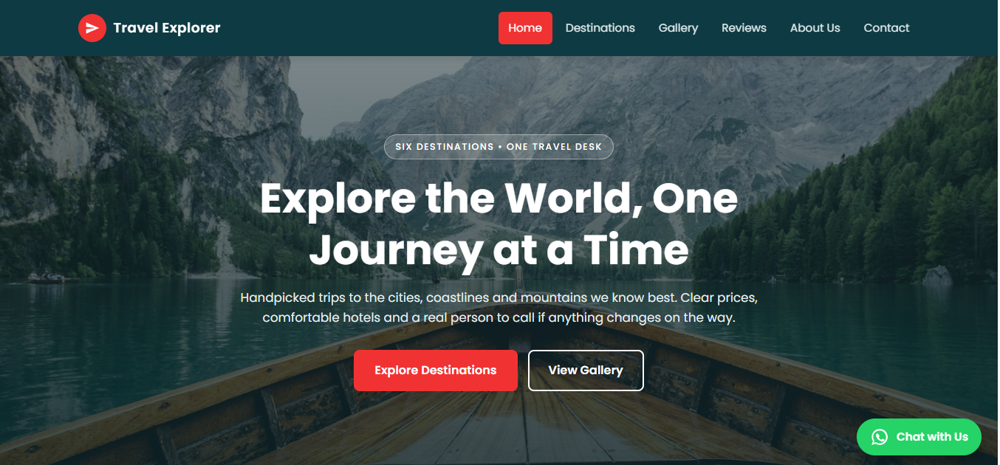

# ✈️ Travel Explorer

A responsive travel agency website built with **HTML5, CSS3, and vanilla JavaScript** as my first front-end project.

The project helped me apply concepts such as **Flexbox, CSS Grid, responsive design, DOM manipulation, form validation, and interactive UI components** while building a complete travel website.

🔗 **[Live Demo](https://aha-shaf.github.io/travel-explorer/)**



## 🌍 About

Travel Explorer features six destinations including Paris, Tokyo, Maldives, Switzerland, Bali, and Dubai.

Users can explore and filter destinations, browse a photo gallery, submit booking requests, and contact the travel desk through WhatsApp or email.

The project is entirely front-end based, so no bookings, payments, or user information are stored.

## ✨ Features

- Responsive design for desktop, tablet, and mobile
- Sticky navigation with active section highlighting
- Mobile hamburger navigation
- Filterable destination cards
- Interactive booking modal
- Client-side form validation
- WhatsApp and email integration
- Responsive image gallery with lightbox
- Accessible form labels, focus states, and ARIA attributes
- Dynamic footer year

## 🛠️ Tech Stack

- **HTML5**: Semantic page structure
- **CSS3**: Flexbox, Grid, positioning, media queries, transitions
- **JavaScript**: DOM manipulation, event handling, filtering, modals, validation
- **Google Fonts**: Poppins
- **Images**: Unsplash and Pexels

No frameworks, libraries, bundlers, or package managers were used.

## 🧠 What I Learned

This project helped me move beyond individual HTML and CSS exercises and understand how different front-end concepts work together in a complete website.

I gained practical experience with:

- Building responsive layouts using Flexbox and CSS Grid
- Manipulating the DOM with vanilla JavaScript
- Handling user interactions and form validation
- Using `data-*` attributes for dynamic behaviour
- Creating modals and image lightboxes
- Designing for different screen sizes
- Organizing HTML, CSS, and JavaScript into separate files
- Applying basic accessibility practices

## 💻 Run Locally

Clone the repository and open `index.html` in your browser.

For a local development server, you can use the **Live Server** extension in VS Code or run:

```bash
python -m http.server 8000
```

Then visit `http://localhost:8000`.

## ⚠️ Limitations

Travel Explorer is a front-end project and does not include a back end.

- Booking requests are prepared for WhatsApp or email rather than stored or processed.
- The contact form uses the visitor's email application.
- Reviews and destination prices are sample content.
- Contact and social information is provided for demonstration purposes.

## 🚀 Future Improvements

- Connect the booking system to a back end
- Generate destination cards dynamically from JavaScript data
- Add a travel price calculator
- Expand individual destination galleries
- Improve the booking workflow
- Add more destinations

## 📚 Credits

Photos from [Unsplash](https://unsplash.com) and [Pexels](https://www.pexels.com).

Font: [Poppins](https://fonts.google.com/specimen/Poppins) via Google Fonts.

---

Built while learning and applying **HTML, CSS, and JavaScript**. Feedback and suggestions are welcome!